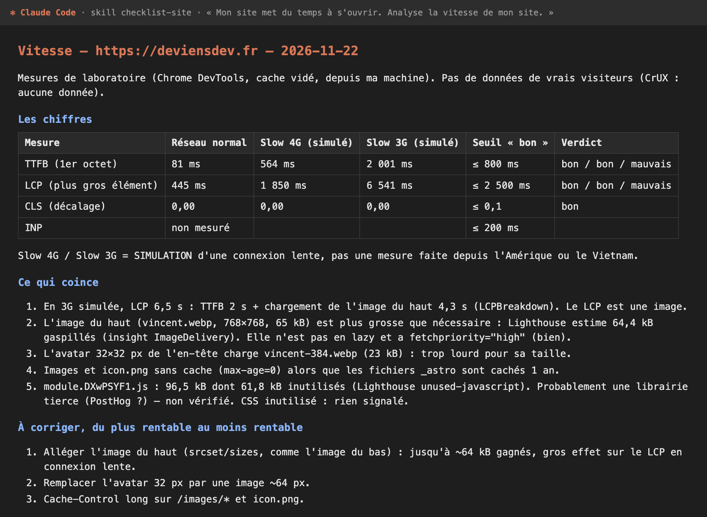

# Ce qui ne va pas sur ton site, chiffres à l'appui

Les prompts que je donne à Claude Code pour vérifier un site : vitesse, sécurité, SEO, légal,
accessibilité. Tu colles un prompt, Claude mesure, te montre les chiffres et ne touche à rien sans ton accord.
Une section prend quelques minutes.



*Le rapport rendu par la skill sur deviensdev.fr, le 22 novembre 2026.*

> Tout est expliqué, schémas à l'appui, sur **[deviensdev.fr/checklist-site](https://deviensdev.fr/checklist-site)**.

## Ce que tu obtiens

| Section | Ce que ça vérifie | Le prompt |
|---|---|---|
| Vitesse | le temps d'ouverture, ce qui charge avant l'affichage, la même mesure sur une connexion lente, le cache, les images | [`prompts/vitesse.md`](prompts/vitesse.md) |
| Sécurité | les clés exposées, la RLS Supabase ou les règles Firebase, les vérifications côté serveur, les en-têtes, CORS, rate limit, `npm audit` | [`prompts/securite.md`](prompts/securite.md) |
| SEO | robots.txt, sitemap, title, description, canonical, H1, le texte lisible sans JavaScript, les robots d'IA | [`prompts/seo.md`](prompts/seo.md) |
| Légal | les cookies posés avant ton accord, le bouton « Tout refuser », les mentions légales, la politique de confidentialité (sources CNIL et service-public.fr, pas un conseil juridique) | [`prompts/legal.md`](prompts/legal.md) |
| Accessibilité | les critères du RGAA : textes alternatifs, contrastes, clavier, focus, langue, étiquettes | [`prompts/accessibilite.md`](prompts/accessibilite.md) |
| Tout d'un coup | les cinq à la suite | [`prompts/tout.md`](prompts/tout.md) |

Chaque prompt commence par mesurer, te montre les chiffres, puis les note dans
`checklist/<section>-AAAA-MM-JJ.md`. Tu refais la même analyse dans un mois, tu compares.

Et la skill `checklist-site` : la même checklist, que Claude lance tout seul quand tu lui dis
« analyse mon site » ou « mon site est lent ».

## Installation

**1. Chrome DevTools MCP** (Claude pilote un vrai Chrome : il en a besoin pour la vitesse, les
cookies et l'accessibilité). Il te faut Google Chrome installé (la version normale suffit) et
Node.js. Dans un terminal :

```
claude mcp add chrome-devtools --scope user npx chrome-devtools-mcp@latest
```

`--scope user` l'installe pour tous tes projets. Pour ce dossier seulement, mets `--scope project`
à la place : Claude Code te demandera de l'approuver au prochain lancement, réponds oui.
Redémarre Claude Code, puis tape `/mcp` : `chrome-devtools` doit être dans la liste.

**2a. Les prompts** : ouvre un fichier de [`prompts/`](prompts/), remplace `https://ton-site.fr` par
ton adresse, colle le bloc dans Claude Code, ouvert dans le dossier de ton site.

**2b. Ou la skill** : dans le dossier de ton site,

```
npx skills add vincentventalon/checklist-site -a claude-code
```

La skill arrive dans `.claude/skills/checklist-site/` (l'outil peut la ranger dans `.agents/skills/`
et y faire un lien : c'est normal, Claude Code la trouve).
À la main, c'est pareil : copie le dossier [`skills/checklist-site/`](skills/checklist-site/) dans
`.claude/skills/` de ton projet, ou dans `~/.claude/skills/` pour l'avoir partout.

## Les phrases à dire

- « Analyse mon site » (les cinq sections)
- « Mon site est lent » (la vitesse)
- « Fais l'audit sécurité de mon site »
- « Fais l'audit SEO de mon site »
- « Mon site est-il en règle avec les cookies ? »

## Ce que ça ne fait pas

- **Mesurer depuis un autre pays.** « Comme si j'étais au Vietnam », c'est une connexion lente
  simulée dans Chrome, et Claude te le dit.
- **Remplacer les vrais visiteurs.** Ce sont des mesures de labo ; les chiffres réels sont dans la
  Google Search Console.
- **Te donner un conseil juridique.** La section légal compare ton site aux pages de la CNIL et de
  service-public.fr, avec les liens. Pour trancher, un professionnel.
- **Tout relire côté sécurité avec `/security-review`.** Cette commande de Claude Code ne relit que
  les changements de ta branche. Le prompt sécurité regarde tout le projet et le site en ligne.

## Ce que ça coûte

Rien de plus que ton abonnement Claude Code. Chrome DevTools MCP et Lighthouse sont gratuits.

## Pannes courantes

| Message | Remède |
|---|---|
| Claude dit qu'il n'a pas d'outil Chrome | Chrome DevTools MCP n'est pas branché : refais l'étape 1, redémarre Claude Code, vérifie avec `/mcp`. |
| Sécurité : « pas de code ici » | Lance Claude Code dans le dossier de ton projet : sans le code, il ne lit que les en-têtes du site. |

## Testé

Le 22 novembre 2026, sur un vrai site en ligne, [deviensdev.fr](https://deviensdev.fr), en lecture seule :

- **La skill**, installée par `npx skills add` (skills 1.9.0, scope projet) puis copiée à la main,
  dans un dossier vide. Elle s'est déclenchée seule sur « mon site met du temps à s'ouvrir ».
- **Les cinq sections**, lancées par Claude Code 2.1.330 (modèle Sonnet) avec
  chrome-devtools-mcp 1.13.0 en Chrome sans fenêtre, et Lighthouse 12.8.2 pour le code inutilisé.
  Quatre sessions (vitesse ; légal et accessibilité ; sécurité et SEO ; accessibilité refaite),
  de 1 min 20 à 2 min 30 chacune, 0,25 à 0,32 $ chacune au prix de l'API. Puis `prompts/tout.md`
  collé tel quel, sans la skill : les cinq sections en 4 min 16 s, 0,67 $.
- **Ce que ça a trouvé** : une ouverture en 0,45 s sur une bonne connexion, mais 6,5 s sur une
  connexion lente simulée, à cause de l'image du haut ; 62 ko de JavaScript chargés pour rien ;
  une page absente du sitemap ; 23 appuis sur Tab, focus toujours visible. Les sections sécurité
  et légal ont rendu leurs points avec leurs preuves (en-têtes, cookies, liens vers la CNIL et
  service-public.fr).

Les prompts ont été corrigés après ce test (ouvrir les pages sources du légal, faire vraiment le tour
au clavier, mesurer le code inutilisé), puis relancés.

## Pour suivre

Je fais un challenge : une vidéo par jour sur [Instagram](https://www.instagram.com/vincentleserpent/)
et [TikTok](https://www.tiktok.com/@vincentleserpent_), et une newsletter le mardi :
[deviensdev.fr](https://deviensdev.fr). Si ce repo t'a servi, une ⭐ m'aide à savoir quoi refaire.

## Licence

MIT
